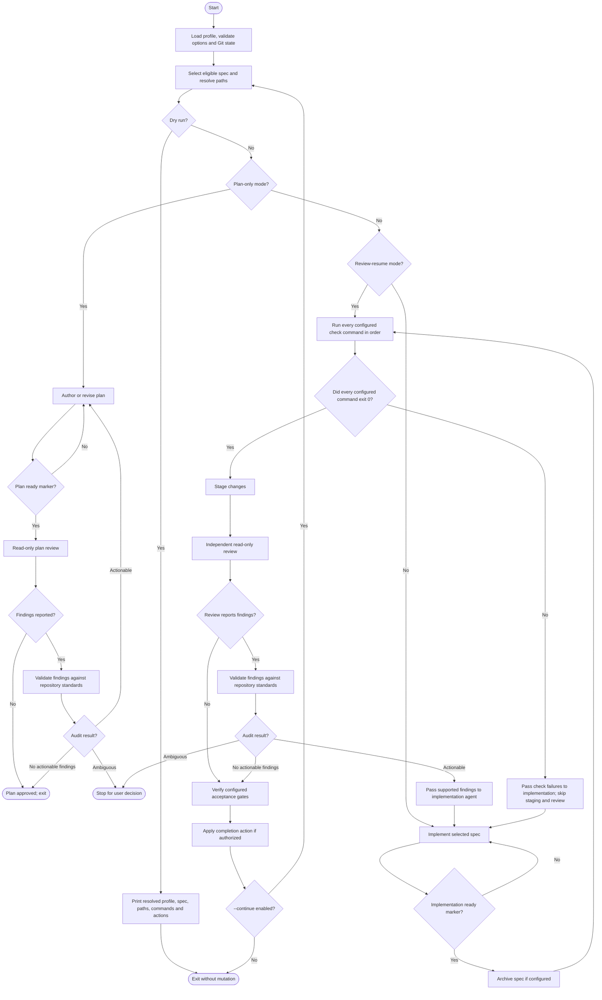

# Generic Spec Loop

**Status:** Active

## Goal

Provide a reusable, as-autonomous-as-possible workflow for implementing
numbered repository specifications. The tool owns common mechanics: spec
selection, agent invocation, response validation, checks, independent review,
Git-state guards, repair loops, and configured completion actions.

After selecting a spec, continue implementation, checks, review, audit, and
repairs without waiting for user input. Run every configured check command. If
any check fails, immediately pass failures to implementation and skip staging
and review for that pass. Stage and review only after all configured checks
succeed. Complete only when checks succeed and review has no supported findings.
Pause only for unresolved ambiguity, unavailable prerequisites, configured
manual gates, or an explicitly configured retry limit.

The target repository owns its spec conventions, prompts, checks, lifecycle
policy, and acceptance gates. Repository instructions and the active spec remain
authoritative. Generic workflow prompts must not weaken them.

## Design principles

- Keep the engine repository-agnostic. Repository-specific rules belong in
  configuration and referenced instruction or prompt files, not engine code.
- Make lifecycle differences configurable: spec selection, planning, archival,
  staged-change policy, completion behavior, and whether to continue to another
  spec.
- Default to preserving user data and avoiding irreversible actions. Never
  discard changes. Commit only when both the user requests it with `--commit`
  and the profile/repository policy permits it.
- Require independent checks and review. Agent completion markers are control
  signals, not proof of correctness.

## Flow



## User interface

The tool runs against the Git worktree in the caller's current directory; its
installation location does not determine the target repository.

```text
spec-loop [--spec ID] [--review] [--plan] [--dry-run]
           [--max-passes N] [--commit] [--continue] [--help]
```

- `--spec ID` selects one eligible spec. ID syntax is defined by the repository
  profile. It is required with `--review` and `--plan`.
- `--review` means implementation is ready: skip initial implementation and
  run configured checks. If any check fails, enter repair implementation and
  skip staging/review for that pass. Review follows only after all checks pass.
  Requires `--spec ID` and staged changes with no unstaged or untracked files.
- Normal `--spec ID` resumes implementation using explicitly pre-staged work
  when present. This supports recovery after an interrupted run. It does not
  infer that staged work is ready for review.
- `--plan` runs plan authoring and plan review only. It is rejected when the
  profile disables plan mode and cannot be combined with `--review`.
- `--dry-run` resolves and prints the profile, spec, paths, commands, and
  intended completion actions without invoking an agent or changing Git state.
  If check list is empty, say no automated checks are configured.
- `--max-passes N` overrides the retry limit. No limit applies by default;
  profile may define a limit. `0` means unlimited.
- `--commit` authorizes a commit only when profile and repository policy permit
  it. Without this flag, leave changes staged and uncommitted.
- `--continue` proceeds to another eligible spec after completion. It requires
  `--commit`, and profile/repository policy must permit both actions. Default
  behavior stops after one spec.
- `--help` describes options, profile discovery, required tools, state
  preconditions, and configuration.
- Invalid options, missing arguments, incompatible options, and invalid IDs
  fail before invoking an agent or changing Git state.

## Implementation and distribution

- Implement CLI in Rust as a standalone binary.
- Distribute prebuilt binaries through GitHub Releases under the MIT License.
  Initial release target: Linux x86_64, statically linked with musl. Git and Pi
  remain external runtime requirements. Do not declare a Rust MSRV.
- Tagged release CI builds and tests the binary, then attaches the binary and a
  checksum to the GitHub Release.
- Use a small agent-backend abstraction with Pi as the first backend. Keep
  workflow policy independent of backend-specific invocation and event parsing.
- Each target repository supplies `.spec-loop.toml` at its root. Parse and
  validate it before doing work. TOML parsing may use a focused Rust crate.
- Commands in profiles are argument arrays, not shell strings. Do not support
  arbitrary shell hooks in the initial version.

## Repository profile

Each target repository supplies a profile describing at least:

- Active and archived spec path patterns, ID extraction, ordering, and
  eligibility rules. Selection must detect duplicate IDs and ambiguous paths
  rather than silently choosing one.
- Whether a requested ID must be next in order, may select any eligible spec,
  or is valid only for archived review.
- Whether plans are required, their path pattern, and whether plan mode is
  enabled.
- Instruction, prompt, and skill files to include for plan authoring,
  implementation, review, review-status normalization, and review-finding
  audit. Required skill instructions must be included in generated prompts; do
  not assume the parent harness prompt is
  inherited by Pi subprocesses.
- Zero or more ordered check commands for focused checks and the full quality
  gate, with labels shown to the reviewer. Commands use argv arrays. Every
  configured command is required; each must exit 0 for the gate to pass. If no
  commands are configured, report that no automated checks ran.
- Agent backend, executable, model or other optional settings, writable and
  read-only invocation policies, selected Pi skills, and required arguments. Pi
  writer defaults use the explicit tool allowlist
  `read,bash,edit,write,grep,find,ls`; MCP, executable extensions, and
  trust-gated project resources require profile opt-in. Pi skills are separate
  instruction resources, not extensions. Reviewer and auditor stay read-only
  with MCP/extensions disabled.
- Optional agent and per-check timeouts. Omitted timeout means unlimited.
- Whether completed specs are archived, the archive destination, and any
  validation required for the transition. Archiving occurs before checks and
  review so the transition is included in the reviewed patch.
- Staging policy, commit message policy, whether commit/continuation are
  allowed, and any maximum pass count. Defaults are no commit, stop after one
  spec, and unlimited passes.
- Automated and manual acceptance gates, including how pending user-owned
  gates are reported.

Configuration and prompt inputs cannot disable Git-state checks, read-only
review, response-marker validation, or the requirement to follow repository
instructions.

## Workflow

### 1. Preflight and selection

1. Resolve the target Git worktree from the caller's current directory and load
   `.spec-loop.toml` from its root.
2. Validate profile, options, configured executables and paths. Select exactly
   one eligible spec and resolve its ID, plan path, and archive counterpart
   when configured. Reject missing, duplicate, symlinked, or otherwise invalid
   required paths.
3. Apply worktree preconditions before invoking an agent:
   - A clean worktree is accepted.
   - Pre-staged changes are accepted when `--spec ID` makes their scope
     explicit. Never discard or silently replace them.
   - Unstaged or untracked non-ignored files are rejected. User must stage
     intended changes before resuming.
   - Plan mode requires a clean worktree.
   - Review-resume requires non-empty staged changes and no unstaged or
     untracked files.
4. Record initial HEAD, status, index/worktree state as applicable, and binary
   diff snapshot. Keep run artifacts outside the worktree.
5. In dry-run mode, print the resolved plan and exit without agent invocation or
   Git mutation.

### 2. Plan-only mode

When enabled, plan mode must:

1. Ask the writable agent to create or revise only the exact configured plan
   file, using the selected spec and repository instructions.
2. Run an independent reviewer with read-only access. The reviewer checks
   requirement coverage, assumptions, scope, sequencing, tests, and configured
   plan requirements without editing files or changing Git state. Every finding
   must cite the applicable spec or repository standard, identify the relevant
   plan section, explain the gap, and propose a proportionate correction.
   Unsupported preferences and speculative requests are not issues.
3. Require the authoring agent's final non-empty response line to be exactly
   `SPEC_LOOP_PLAN=READY_FOR_REVIEW`. Require the reviewer's final non-empty
   line to be exactly `SPEC_LOOP_PLAN_REVIEW=ISSUES` or
   `SPEC_LOOP_PLAN_REVIEW=NO_ISSUES`. If the reviewer status line is
   noncanonical, invoke a separate read-only status auditor before deciding the
   review result.
   Give it only the raw reviewer response and the allowed status meanings; it
   must not inspect the plan, spec, or repository for new findings. For every
   noncanonical status line, it must interpret the response and return exactly
   one canonical result: `ISSUES` when the reviewer reports findings,
   `NO_ISSUES` when it reports no findings, or `AMBIGUOUS` when intent is
   conflicting or indeterminate. The status auditor must not add, remove, or revise findings.
   Require its final line to be exactly
   `SPEC_LOOP_PLAN_REVIEW_STATUS_AUDIT=ISSUES`,
   `SPEC_LOOP_PLAN_REVIEW_STATUS_AUDIT=NO_ISSUES`, or
   `SPEC_LOOP_PLAN_REVIEW_STATUS_AUDIT=AMBIGUOUS`. Preserve raw response and
   normalized status separately; never rewrite the agent response. Ambiguity
   stops for user decision. This recovery applies only to review-status lines;
   author readiness and finding-auditor markers remain exact and fail closed.
4. If the canonical review result is `ISSUES`, run a separate read-only finding
   auditor that checks only those findings against the selected active spec,
   source requirements, and authoritative repository standards, including
   `AGENTS.md` and applicable architecture documentation/contracts. It must not
   inspect for additional issues, invent findings, or change files. Classify
   every finding as
   supported, unsupported, or ambiguous, with rationale, and finish with
   `SPEC_LOOP_PLAN_AUDIT=ACTIONABLE`,
   `SPEC_LOOP_PLAN_AUDIT=NO_ACTIONABLE_FINDINGS`, or
   `SPEC_LOOP_PLAN_AUDIT=AMBIGUOUS`. Keep supported findings actionable and
   return them to the plan author. Remove unsupported findings from the
   actionable set when evidence shows they contradict the active spec, other
   authoritative requirements, or repository standards; preserve original
   reviewer output and audit trail. Ambiguous findings stop for user decision.
   Skip finding audit when the canonical review result is `NO_ISSUES`.
5. On actionable findings or incomplete work, pass validated findings back to
   the plan author and repeat. On approval, exit successfully without
   implementation, staging, commit, or history changes.
6. Verify after every agent call, including status and finding audits, that HEAD
   and Git state are unchanged, except for the configured plan file if it is
   intentionally excluded from Git. Verify no other file was created or
   modified.

### 3. Implementation passes

1. Build an implementation prompt from generic workflow instructions, the
   selected spec, required plan (when configured), and profile-supplied
   repository instructions.
2. Run the configured writable agent. Require it to implement only the selected
   spec, run focused tests while iterating, and avoid staging, committing, or
   changing Git history. The engine snapshots the index around each writer call
   and stops if the writer stages changes.
3. Accept completion only when the final non-empty response line is exactly
   `SPEC_LOOP_IMPLEMENTATION=READY_FOR_REVIEW`. An incomplete response is
   feedback, not success; continue implementation passes.
4. Verify after each agent invocation that HEAD and index did not change. Stop
   if an agent changes either or violates configured filesystem/Git-state
   boundaries; do not reset or roll back the mutation.
5. Apply configured archive transition before checks. Validate the destination,
   forbidden duplicate/root copies, and configured link/reference checks. The
   archive change remains part of the review input, staged only if checks pass.

### 4. Checks and repair

1. Run every configured check command in order and log complete output and exit
   status. Run the full list even when an earlier command fails or times out. A
   timeout is a failed check; continue with remaining commands. The check gate
   passes only when every configured command exits 0. An empty list means no
   automated checks ran and must be reported.
2. If any check fails, immediately pass all check diagnostics to the writable
   agent. Do not stage or review that pass. After repair, rerun the entire
   configured list from its first command. Only proceed to staging and review
   after every configured command succeeds.
3. In review-resume mode, snapshot HEAD and staged patch before checks. If all
   checks pass, verify they did not modify review input before staging/review.
   If any check fails, skip review and enter implementation repair.

### 5. Staging, review, and review audit

1. Stage changes only after every configured check command exits 0. If any
   check fails, do not invoke staging or review; preserve any existing staged
   input and return directly to implementation repair.
2. Capture changed paths and the complete staged diff against HEAD after staging.
   Include all changes produced by implementation and configured archive
   transition.
3. Invoke a separate reviewer with read-only tools and profile-supplied review
   instructions. The reviewer checks implementation against the full spec,
   plan, changed files, repository instructions, and check results. Every
   finding must cite the applicable requirement or standard, identify exact
   location and observed evidence, explain the violation, and propose a
   proportionate correction. Findings must be actionable and in scope; style
   preferences, speculative risks, and requests unsupported by repository
   standards are not issues. The reviewer must not edit, stage, commit, archive,
   or alter Git state.
4. Require the final non-empty response line to be exactly
   `SPEC_LOOP_REVIEW=ISSUES` or `SPEC_LOOP_REVIEW=NO_ISSUES`. If the reviewer
   status line is noncanonical, invoke a separate read-only status auditor
   before deciding the review result. Give it only the raw reviewer response
   and allowed status meanings; it must not inspect implementation, spec, plan,
   or repository for new findings. For every noncanonical status line, it must
   interpret the response and return exactly one canonical result: `ISSUES`
   when the reviewer reports findings, `NO_ISSUES` when it reports no findings,
   or `AMBIGUOUS` when intent is conflicting or indeterminate. It must not add,
   remove, or revise findings. Require its final line to be exactly
   `SPEC_LOOP_REVIEW_STATUS_AUDIT=ISSUES`,
   `SPEC_LOOP_REVIEW_STATUS_AUDIT=NO_ISSUES`, or
   `SPEC_LOOP_REVIEW_STATUS_AUDIT=AMBIGUOUS`. Preserve raw response and
   normalized status separately; never rewrite the response. Ambiguity stops
   for user decision. This recovery applies only to reviewer status lines;
   implementation readiness and finding-auditor markers remain exact and fail
   closed.
5. If the canonical review result is `ISSUES`, run a separate read-only finding
   auditor against the reported findings, active spec, repository instructions
   (including `AGENTS.md`), applicable architecture documentation/contracts,
   plan, and relevant code evidence. The finding auditor validates only reported
   findings against these authoritative standards. It must not independently
   search for missed issues, invent findings, or change files. Require final line
   `SPEC_LOOP_REVIEW_AUDIT=ACTIONABLE`,
   `SPEC_LOOP_REVIEW_AUDIT=NO_ACTIONABLE_FINDINGS`, or
   `SPEC_LOOP_REVIEW_AUDIT=AMBIGUOUS`. If the canonical review result is
   `NO_ISSUES`, skip finding audit and proceed to configured acceptance gates.
6. The audit report classifies every reported finding as supported,
   unsupported, or ambiguous, with rationale. Supported findings remain
   required fixes. Remove unsupported findings from the actionable set when
   they contradict the active spec or other authoritative requirements, or lack
   supporting evidence; preserve the original review response and audit trail.
   Ambiguous findings
   stop without approval or commit and are surfaced for user decision. Invalid
   audit output fails closed.
7. Verify HEAD, index, worktree status, tracked binary diff, and untracked
   review-file contents are unchanged by review and audit. If supported findings
   remain, send only those findings to the writable agent and repeat
   implementation, checks, staging, review, and audit. Later review rounds may
   identify omissions; the auditor does not
   search for them.
8. Apply configured acceptance gates. Report pending user-owned gates as
   pending; never claim they passed or silently convert them into agent tasks.

### 6. Completion

After review approval and all configured gates:

- Without `--commit`, leave changes staged and uncommitted.
- With `--commit`, commit only if the profile and repository policy permit it.
  Before committing, verify the reviewed HEAD, staged patch, and worktree state
  still match the approved snapshot. Use the configured commit message policy.
- Continue to another spec only when `--continue` is supplied with `--commit`
  and the profile/repository policy permits both. Require a clean worktree
  after commit before selecting another spec.
- Otherwise stop after one spec. Report selected spec, checks, review result,
  completion action, pending manual gates, and run-log locations.

## Agent invocation and response handling

- Use the Rust agent-backend abstraction; Pi is the first backend. Invoke it in
  non-interactive, machine-readable mode where available. Include required
  skill instructions in generated prompts; optionally pass selected skill paths
  with Pi's `--skill`. Do not enable executable extensions merely to use a skill.
- Preserve raw event output and a separate extracted final assistant response.
  Accept a response only after a successful, settled run with a complete
  assistant response. Aborted, errored, truncated, malformed, or unsettled runs
  fail closed and cannot satisfy a completion marker.
- Require exact markers for writer readiness and finding-auditor outcomes. For a
  noncanonical plan-review or implementation-review status only, invoke the
  read-only status auditor defined above. For every noncanonical status, it
  returns canonical `ISSUES`, `NO_ISSUES`, or `AMBIGUOUS` based only on the
  reviewer response; it cannot inspect source requirements or find issues.
  Retain raw and normalized responses separately. An ambiguous status
  or invalid status-auditor marker fails closed; do not recursively audit the
  status auditor.
- Report selected and provider-reported model identities when available.
- Enforce reviewer and auditor read-only access at the tool/permission layer,
  not only through prompt wording. Independently verify Git state after each
  pass.
- Retry without a limit by default. Apply profile or `--max-passes N` limit
  when configured; `0` means unlimited. Count writable author/implementation
  calls per phase; reviewer and auditor calls do not count. Timed-out writer
  calls count and feed failure context into the next pass. On reaching a limit,
  stop without discarding changes and print recovery instructions.
- Agent and check timeouts are optional profile settings; omitted means
  unlimited. A timed-out agent call preserves changes and is treated as an
  incomplete writer pass. A timed-out check is a failure; run remaining checks,
  then skip staging/review and pass failures to implementation.
- Store run logs in a run-specific directory under the system temporary
  directory and retain them after exit. Clean ephemeral prompts and patch
  snapshots on normal exit and handled signals, without deleting user data or
  any path inside the worktree.

## Git and failure safety

- Instruct agents not to stage, commit, alter history, or change HEAD. Record
  HEAD and index before each writable-agent call and compare afterward; if
  either changed, stop without resetting or otherwise undoing the mutation. The
  engine stages only after all configured checks pass. Check failures return
  directly to implementation and skip staging/review for that pass.
- Before read-only review/audit, record HEAD, Git status, tracked binary diff,
  and content snapshots for untracked review files. Verify all remain identical
  afterward; stop if reviewer or auditor changed Git state. Plan mode also
  verifies HEAD/status and permits changes only to its configured plan file.
- The engine owns configured staging and authorized commits. Never commit while
  a check is failing, a supported review finding remains unresolved, an audit is
  ambiguous, or any snapshot/archive guard has failed. A failed check skips
  staging and review and immediately returns to implementation repair.
- Fail closed on ambiguous spec selection, stale review input, detected Git
  mutation, missing tools, malformed agent output, or unknown response marker.
- Preserve user changes. Never reset, checkout, clean, stash, or silently
  discard files to make a run proceed.
- Check symlink and path boundaries before writing plans, temporary files, or
  archives. Temporary storage must resolve outside the target worktree.
- Keep configured commands explicit argv arrays. Do not interpolate untrusted
  spec text into command arguments or shell syntax.

## Acceptance criteria

1. The engine contains no repository names or domain-specific implementation
   policy. Workflow differences are expressed through profiles and referenced
   files.
2. At least two example profiles demonstrate distinct supported combinations
   of selection, planning, checks, archiving, review-resume, completion, and
   continuation policies.
3. Automated tests use temporary Git repositories and a fake Pi backend; tests
   need no network, live agent session, or project build.
4. Tests cover option/config errors, selection ordering and ambiguity,
   profile lifecycle combinations, plan-only restrictions, incomplete/error
   agent runs, check failures and repairs, all-command execution, empty-list
   reporting, timeouts, successful-check staging before review, no staging on
   failure, exact review/audit markers, normalization of noncanonical review
   statuses into canonical outcomes, ambiguous status reports, malformed
   status-auditor output, preservation of raw responses, and finding-audit
   cases where unsupported reports contradict the active spec, `AGENTS.md`, or
   architecture contracts and are removed from the actionable set, supported
   findings remain,
   ambiguous findings stop for user input, and auditors add no findings;
   review-resume snapshots, writer index mutation,
   reviewer/auditor Git mutation, archive validation, staged-change preservation,
   retry limits, dry-run purity, and completion/commit guards.
5. Failure-path tests prove the engine does not initiate a commit after a
   failed guard and never discards user changes. If an agent changes HEAD, the
   engine detects it, stops, and does not reset or roll back the mutation.
6. Project includes MIT `LICENSE`; release CI builds and tests Linux x86_64
   musl binary on a tagged release and publishes binary plus checksum to GitHub
   Releases.
7. User-facing help documents options, profile discovery, required tools, state
   preconditions, retry behavior, and the authority of repository instructions.

## Out of scope

- Replacing a target repository's spec format, numbering, queue, or
  instructions.
- Moving domain research requirements or project-specific prompt content into
  generic engine code.
- Automatically writing, promoting, reprioritizing, or approving specs.
- Treating an agent's marker as proof that implementation is correct.
- Allowing the review auditor to generate new findings or search for omissions.
- Accepting review findings without checking them against repository standards.
- Running unavailable or user-owned acceptance gates unless the profile defines
  an available automated command.

## Deferred implementation details

- Exact TOML schema and validation rules.
- Exact dependency versions and CI toolchain pin. No Rust MSRV is declared.
- GitHub release workflow naming, binary naming, and checksum algorithm.
- Exact Pi argument mapping and event schema under the backend abstraction.
