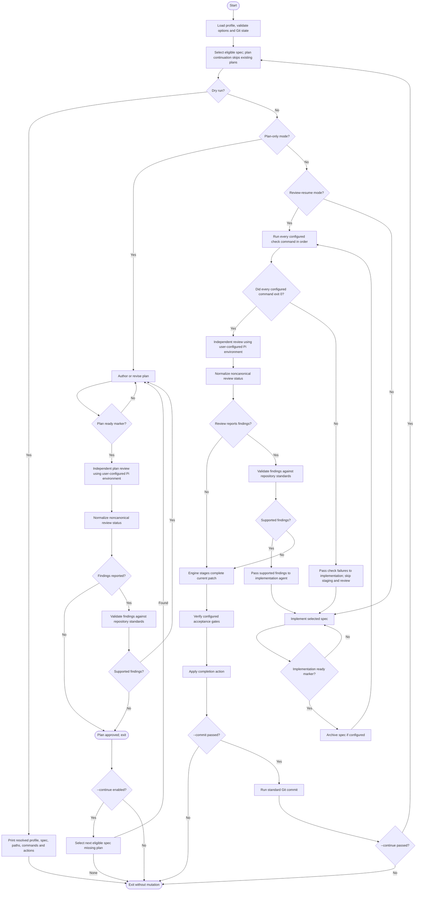

# Generic Spec Loop

**Status:** Complete

## Goal

Provide a reusable, autonomous workflow for numbered repository specifications.
Plan creation/review is a separate process from implementation. Given a spec and
approved plan, implementation, checks, grounded review, repair, authorized commit,
and continuation run without per-turn user input.

Run every configured check. Any failure goes to implementation repair. Preserve
existing staging; after checks pass, review the complete combined patch before
staging. Stage only when no actionable findings remain. Ground reported findings against the
active spec and repository rules. Ask reviewer once for evidence when a finding is
unproven; discard it if still unproven. Keep supported findings even when
reviewer's proposed fix is poor: require smallest architecture-aligned fix with
no refactoring. Repeat until no actionable findings remain. `--commit` and
`--continue` are both required for multi-spec implementation. Retries and
timeouts are unlimited by default; configured limits override this.

Use lightweight Git-visible status only to preserve and process changes; it is
not a reason to inspect every filesystem change. Ignore Git-ignored artifacts in
status and patch processing. Do not stop for ignored-file changes, incomplete
or failed agent responses, failed checks, or unsupported review requests; feed
them into the appropriate retry or repair loop. Pause only when progress is
genuinely impossible, such as a missing prerequisite, explicit user
cancellation, or configured manual gate. Before review approval,
preserve and include ordinary index/worktree changes in checks and review. After
approval, do not recheck or re-review solely because worktree or index changed
before commit; standard Git staging and commit behavior decides what is included.
Repository rules decide what fixes are valid. The selected active spec is
read-only workflow input: Spec Loop and its agents must never edit or rewrite its
contents or requirements. Only the user may revise it. Configured archival may
move the unchanged spec after approved completion. Plans may be created or revised
only by PlanAuthor during explicit `--plan`; implementation, review, and audit
roles must treat the selected plan as read-only.

The target repository owns its spec conventions, prompts, checks, lifecycle
policy, and acceptance gates. Repository instructions and the active spec remain
authoritative. Generic workflow prompts must not weaken them.

## Design principles

- Keep the engine repository-agnostic. Repository-specific rules belong in
  configuration and referenced instruction or prompt files, not engine code.
- Use profiles for spec selection, planning, archival, commit-message policy,
  and retry limits. CLI switches alone authorize commit and continuation.
- Preserve user data; never reset, clean, stash, or discard changes. `--commit`
  authorizes a standard Git commit after review approval; multi-spec implementation
  also requires `--continue`. CLI switches are sole commit/continuation gates.
- Require independent checks and review. Agent completion markers are control
  signals, not proof of correctness.

## Flow



## User interface

The tool runs against the Git worktree in the caller's current directory; its
installation location does not determine the target repository.

```text
spec-loop [--spec ID] [--review | --plan] [--dry-run]
           [--commit] [--continue] [--help]
```

- `--spec ID` selects the first eligible spec to process. ID syntax is defined
  by the repository profile. It is required with `--review` and `--plan`;
  otherwise the next eligible spec is selected by default.
- `--review` means implementation is ready: skip initial implementation and
  run configured checks. If any check fails, enter repair implementation and
  skip staging/review for that pass. Review follows only after all checks pass.
  Requires `--spec ID` and non-empty combined Git-visible changes; accepts
  staged, unstaged, and untracked changes. Normal `--spec ID` preserves
  pre-staged, unstaged, and untracked work and includes it in checks/review; it
  does not infer that existing staged work is ready for review.
- `--plan` runs separate plan-only process; every implementation requires an
  approved plan. `--plan --continue` skips existing plan files and creates/reviews
  plans for successive specs missing plans. Explicit `--spec ID --plan` without
  `--continue` revises that plan even when file already exists. Plan mode cannot combine with
  `--review` or `--commit`.
- `--dry-run` resolves and prints the profile, spec, paths, commands, and
  intended completion actions without invoking an agent or changing Git state.
  If check list is empty, say no automated checks are configured.
- Retry limit is configured only in profile as `completion.max_passes`; default
  `0` means unlimited. It applies to every Pi role, including reviewers and
  auditors. No CLI retry-limit override exists.
- In implementation mode, engine stages the complete current patch only after
  checks pass and review has no actionable findings. Without `--commit`, leave
  that approved patch staged. `--commit` authorizes standard Git commit without
  an additional profile permission; multi-spec implementation requires both
  `--commit` and `--continue`. Plan mode uses `--continue` without commit to
  process successive missing plans.
- `--help` describes options, profile discovery, required tools, state
  preconditions, and configuration.
- Invalid options, missing arguments, incompatible options, and invalid IDs
  fail before invoking an agent or changing Git state.

## Implementation and distribution

- Implement CLI in Rust as a standalone binary.
- Distribute prebuilt binaries through GitHub Releases under the MIT License.
  Initial release target: Linux x86_64, statically linked with musl. Git and Pi
  remain external runtime requirements. Do not declare a Rust MSRV.
- Tagged release CI builds and tests the binary, then attaches the binary and a
  checksum to the GitHub Release.
- Use a small agent-backend abstraction with Pi as the first backend. Keep
  workflow policy independent of backend-specific invocation and event parsing.
- Each target repository supplies `.spec-loop.toml` at its root. Parse and
  validate it before doing work. TOML parsing may use a focused Rust crate.
- Commands in profiles are argument arrays, not shell strings. Do not support
  arbitrary shell hooks in the initial version.

## Repository profile

Each target repository supplies a profile describing at least:

- Active spec path patterns, ID extraction, ordering, and eligibility rules.
  Selection must reject duplicate IDs rather than silently choosing one.
  Archived specs are archival outputs, not discovery or review candidates.
- Whether a requested active ID must be next in order or may select any
  eligible active spec. There is no archived-spec review mode.
- Plan path template. Every implementation requires an approved plan; plan mode
  is always available. There is no `required` or `enabled` toggle.
- Repository instruction and workflow prompt files for plan authoring,
  implementation, review, status normalization, and finding grounding. Pi
  configuration alone controls skills and extensions; do not inject or override
  those resources.
- Zero or more ordered check commands for focused checks and the full quality
  gate, with labels shown to the reviewer. Commands use argv arrays. Every
  configured command is required; each must exit 0 for the gate to pass. If no
  commands are configured, report that no automated checks ran.
- Agent backend, executable, and required protocol arguments. Preserve the
  user's effective Pi configuration and inherited process environment across all
  roles, including tool settings,
  extensions, MCP servers, skills, project trust, and context files. The profile
  schema must not expose overrides for these resources, and invocations must not
  pass flags that restrict or replace them. Run every role from repository root
  so Pi loads project settings, trust, and context files. The engine may set
  protocol-required options such as `--no-session`, `--mode json`, and the
  generated prompt, plus explicitly configured model/thinking overrides. Review
  and audit are agent tasks, not tool sandboxes: prompt agents not to mutate.
  Use lightweight Git-visible checks before review approval; ignore ignored
  artifacts. After approval, do not revalidate worktree/index before commit.
  Extensions and MCPs may cause external effects that Git-visible checks cannot
  detect or reverse; document this user-owned risk.
- Optional model/thinking defaults in `[agent]` and independent settings in
  `[agent.stages.planning]`, `[agent.stages.implementation]`, and
  `[agent.stages.review]`. Planning settings apply to plan author and plan
  reviewer; implementation settings apply to implementer; review settings apply
  to implementation reviewer and all status/finding auditors. Each omitted
  field inherits global `[agent]`, then Pi's configured default. Model settings
  never override Pi tools, extensions, MCP, skills, trust, or context.
- Optional agent and per-check timeouts. Omitted timeout means unlimited.
- Whether completed specs are archived, the archive destination directory, and
  any validation required for the transition. Preserve the selected spec's
  filename. Archiving occurs before checks and review so transition is included
  in reviewed patch. Archived files are not discovery candidates. If archiving
  is disabled, do not move or mark specs complete: skip completed IDs only for
  current run; user owns archiving them to prevent selection in future runs.
- Commit message policy and maximum pass count. CLI `--commit` and `--continue`
  switches are the sole authorizations; the profile has no `commit_allowed` or
  `continue_allowed` fields. Defaults are no commit, stop after one spec, and
  unlimited passes.
- Automated and manual acceptance gates, including how pending user-owned
  gates are reported.

Configuration cannot disable essential preflight checks, response-marker
validation, or the requirement to follow repository instructions. Malformed agent responses trigger retries by default, not a user
stop. Preserve user-configured agent tools and resources; do not claim reviewers
or auditors are sandboxed when extensions or MCPs may execute with process
permissions.

## Workflow

### 1. Preflight and selection

1. Resolve the target Git worktree from the caller's current directory and load
   `.spec-loop.toml` from its root.
2. Validate profile, options, configured executables and paths. Select eligible
   spec and resolve its ID, plan path, and archive destination. In implementation
   mode, require existing approved plan before invoking writer; if missing, report
   `spec-loop --spec ID --plan`. In `--plan --continue`, skip specs with existing
   plan files. Reject missing, duplicate, or invalid required resources.
3. Preserve Git-visible user work; a clean state (no unstaged or untracked
   changes; staged changes may remain) is accepted but not required. Do not
   reject ordinary staged, unstaged, or untracked non-ignored changes.
   Include them in implementation checks and combined review; never discard or
   infer ownership. Plan mode preserves them without staging or committing them.
   `--review` skips initial writer and requires a non-empty combined Git-visible
   patch; accept staged, unstaged, and untracked changes.
4. Record only compact Git-visible state needed for selection and detecting
   changes before review approval. Do not snapshot the whole filesystem or retain
   full changed-file contents. Ignore Git-ignored files; keep run artifacts
   outside worktree.
5. In dry-run mode, print the resolved plan and exit without agent invocation or
   Git mutation.

### 2. Separate plan process

Every implementation requires an approved plan. `--plan` is always available
and runs separately from implementation; it never stages, commits, or launches
implementation.

- `--plan --continue` starts at required `--spec ID`, skips specs with existing
  plan files, and authors/reviews plans for successive eligible specs missing
  plans. Existing plan file is handoff artifact; explicit `--spec ID --plan`
  without `--continue` is the re-review/revision path. If none are missing,
  report that and exit.
- `--spec ID --plan` without `--continue` author/reviews that plan even when its
  file already exists, allowing explicit revision.
- Each plan follows author → review → status normalization if needed → finding
  grounding → fix/revise until no supported findings remain. Return only
  supported findings. Evaluate defect separately from proposed remedy: retain
  supported defects, but require smallest architecture-aligned correction with
  no refactoring. If finding lacks evidence, ask reviewer once for evidence;
  discard if still unproven.
- Canonical plan-review status is used directly. Otherwise status auditor
  receives raw reviewer response and allowed meanings, and returns exactly
  `SPEC_LOOP_PLAN_REVIEW_STATUS_AUDIT=ISSUES`,
  `SPEC_LOOP_PLAN_REVIEW_STATUS_AUDIT=NO_ISSUES`, or
  `SPEC_LOOP_PLAN_REVIEW_STATUS_AUDIT=AMBIGUOUS`. Prompt it not to inspect plan,
  spec, or repository for findings; preserve raw and normalized responses.
  Retry malformed auditor output. For `AMBIGUOUS`, ask reviewer once to clarify;
  surface only unresolved ambiguity.
- Print each completed role response with role label; retain raw logs.
- Preserve user changes. Ignore Git-ignored artifacts; do not snapshot the whole
  filesystem or roll back changes. Plan calls do not initiate implementation.

### 3. Implementation passes

Implementation is a separate process after approved plan exists. Continue
without per-turn user input:

1. Implement selected spec and required plan. Prompt agent not to stage, commit,
   or alter history; shared index/worktree changes from user or agent are preserved
   and included in combined changeset. Do not reject changes for unclear provenance.
2. Retry every failed or malformed Pi role call indefinitely by default. The
   profile's `completion.max_passes` limit applies to every Pi role, including
   reviewers and auditors; `0` means unlimited.
3. After implementation reports ready, run configured archive transition,
   checks, review, and finding grounding. Failed checks and supported findings
   return to implementation. Require smallest architecture-aligned fixes; do not
   refactor. Engine does not stage during implementation, checks, review, or
   repair; it stages the complete current patch only after review has no
   actionable findings.
4. Ignore Git-ignored artifacts. Before review approval, detected Git-visible
   changes require checks and review against the updated combined patch. Once
   reviewer approval arrives, do not snapshot or compare the worktree/index or
   rerun checks/review before staging or commit, even if files change. Assume one
   workflow operator; do not detect concurrent user/agent Git mutations.
5. If archiving is disabled, skip completed ID only for current run. User owns
   archiving completed specs to prevent selection in later runs.

### 4. Checks and repair

1. Run every configured check command in order and log complete output and exit
   status. Run the full list even when an earlier command fails or times out. A
   timeout is a failed check; continue with remaining commands. The check gate
   passes only when every configured command exits 0. An empty list means no
   automated checks ran and must be reported.
2. If any check fails, immediately pass a concise, actionable failure summary to
   the writable agent, including command, exit status, relevant error excerpts,
   and log path. Keep complete output in run logs; do not embed full test output
   in prompts. Do not stage or review that pass. After repair, rerun the entire
   configured list from its first command. Proceed to review only after every
   configured command succeeds; stage only after review has no actionable findings.
3. Before each check cycle, capture a compact identity for the complete
   Git-visible patch (index, worktree, and untracked files). If configured checks
   change that input, preserve it and rerun the full check list against updated
   patch before review; do not stop or roll it back. This applies to normal runs
   and `--review`. If any check fails, skip review and enter implementation
   repair. This is not a mechanism for detecting concurrent repository users.

### 5. Staging, review, and grounded repair

1. Preserve existing user staging on every outcome. Engine does not stage during
   implementation, checks, review, or repair. After checks succeed and review has
   no actionable findings, engine stages the complete current non-ignored patch.
   Any check failure or actionable finding returns work to implementation without
   engine staging.
2. Reviewer uses user-configured Pi tools to inspect the complete combined
   staged, unstaged, and untracked patch against the spec, plan, repository
   instructions, and check results. Review happens before engine staging. Engine
   passes paths and concise check summaries with log paths, not copied repository
   files, full test output, or a generated diff. Findings cite a requirement/rule
   and evidence. An out-of-scope
   file being changed is not a finding by itself; its contents must still comply
   with repository rules. Report only concrete violations, not file-location
   scope policing. Prompts request no mutations; Pi resources remain user-configured.
3. A canonical `SPEC_LOOP_REVIEW=NO_ISSUES` ends review;
   `SPEC_LOOP_REVIEW=ISSUES` starts grounded finding review. For a noncanonical
   or missing status, invoke dedicated status auditor with only raw reviewer
   response and allowed meanings. Its prompt instructs it not to inspect
   implementation/spec or add, remove, or revise findings. Pi resources remain
   user-configured, not sandboxed. Preserve raw response and normalized status
   separately; require final marker exactly `SPEC_LOOP_REVIEW_STATUS_AUDIT=ISSUES`,
   `SPEC_LOOP_REVIEW_STATUS_AUDIT=NO_ISSUES`, or
   `SPEC_LOOP_REVIEW_STATUS_AUDIT=AMBIGUOUS`. Retry malformed auditor output with
   format feedback. If auditor returns `AMBIGUOUS`, retry reviewer once with a
   request to clarify; pause only if intent remains genuinely indeterminate.
4. Ground only findings reviewer reported against spec, `AGENTS.md`,
   architecture/contracts, plan, and code using user-configured Pi tools. Engine
   passes paths and reported findings, not copied repository files. Keep a
   supported defect even if
   proposed fix is over-engineered or conflicts with architecture; discard bad
   remedy and require smallest architecture-aligned fix with no refactoring. If
   finding lacks evidence, ask reviewer once for evidence; discard if still
   unproven. Preferences, speculative risks, and unsupported claims are not
   actionable.
5. Send supported findings to implementation; discard unsupported findings.
   Rerun checks, review, and grounding until no actionable findings remain. Then
   the engine stages the complete current non-ignored patch; agents never stage.
   Malformed grounding output retries with format feedback.
6. Ignore Git-ignored artifacts. Do not scan the entire filesystem or use
   index/worktree snapshots as ownership guards. Preserve and include user/agent
   index and worktree changes in checks and review before approval. Once reviewer
   returns `SPEC_LOOP_REVIEW=NO_ISSUES` (or grounding leaves no actionable
   findings), approval is final: do not snapshot or compare worktree/index or
   rerun checks/review between approval, engine staging, and commit, even if files
   change. Changes in this interval may be staged or committed without review.
   Assume one workflow operator; do not detect concurrent user/agent staging,
   commits, or other Git mutations. Use standard Git behavior when `--commit` is
   passed. Never reset, clean, stash, or roll back.
7. Apply configured automated acceptance gates. Manual gates are opt-in and
   explicitly pause unattended completion.

### 6. Completion

- Without `--commit`, leave the staged patch and stop after selected spec. With
  `--commit`, run standard Git commit; no profile permission is required.
  Multi-spec implementation requires both `--commit` and `--continue`; skip IDs
  completed during current invocation. Worktree/index changes after review
  approval do not trigger rechecks or re-review before staging or commit; normal
  Git behavior determines which changes enter the commit.
- If archiving is disabled, leave completed spec active and do not mark it
  complete. A later invocation may select it again; user must archive it or
  change its eligibility to prevent reimplementation.
- Report specs, checks, reviews, commits, pending gates, and
  run-log locations.

## Agent invocation and response handling

- Use the Rust agent-backend abstraction; Pi is the first backend. Invoke it in
  non-interactive, machine-readable mode where available. Let Pi load user- and
  project-configured skills and extensions. Do not expose profile resource fields
  or pass resource flags such as `--tools`, `--extension`, `--skill`, `--mcp`, or
  `--approve`; the user's Pi configuration alone controls availability.
- Preserve raw event output and a separate extracted final assistant response.
  Print each role-labeled final response to terminal after its call completes;
  retain logs and do not stream partial text. Print available response text and
  diagnostics for failed attempts when present. Only a successful, settled run
  with a complete response can satisfy a marker; incomplete attempts retry.
- Resolve per-call model/thinking from `[agent.stages.planning]`,
  `[agent.stages.implementation]`, or `[agent.stages.review]`, then global
  `[agent]`, then Pi defaults. Plan author/reviewer use planning stage; writer
  uses implementation stage; implementation reviewer and all auditors use
  review stage.
- Require final non-empty line `SPEC_LOOP_PLAN=READY_FOR_REVIEW` from plan
  author and `SPEC_LOOP_IMPLEMENTATION=READY_FOR_REVIEW` from implementer. Missing
  or malformed readiness markers return to same role as feedback.
- Plan reviewer final line is exactly `SPEC_LOOP_PLAN_REVIEW=ISSUES` or
  `SPEC_LOOP_PLAN_REVIEW=NO_ISSUES`; implementation reviewer uses
  `SPEC_LOOP_REVIEW=ISSUES` or `SPEC_LOOP_REVIEW=NO_ISSUES`. `ISSUES` requires
  sequential `FINDING-N:` entries; `NO_ISSUES` requires none. For missing or
  noncanonical status, use dedicated status auditor; preserve raw/normalized
  responses separately. Its task prompt contains raw response and allowed meanings,
  and asks for no source
  inspection or new findings. Require exact role-specific final marker ending
  `=ISSUES`, `=NO_ISSUES`, or `=AMBIGUOUS`. Retry malformed auditor output.
  If ambiguous, ask reviewer once to clarify; pause only if still unclear.
- For `ISSUES`, reviewers emit sequential `FINDING-N:` lines with source rule,
  location, evidence, violation, and proposed correction. Finding grounder
  classifies every reported ID exactly once as supported, unsupported, or
  ambiguous; preserve finding text and provide separate rationale. Require
  `SUPPORTED_FINDINGS`, `UNSUPPORTED_FINDINGS`, and `AMBIGUOUS_FINDINGS` sections;
  repeat each original line verbatim followed by ` | AUDIT RATIONALE: ...`.
  Finish with exactly one matching marker: `SPEC_LOOP_PLAN_AUDIT=ACTIONABLE`,
  `SPEC_LOOP_PLAN_AUDIT=NO_ACTIONABLE_FINDINGS`, or
  `SPEC_LOOP_PLAN_AUDIT=AMBIGUOUS`; implementation uses corresponding
  `SPEC_LOOP_REVIEW_AUDIT=...` markers. Ask reviewer once for evidence on
  ambiguous or unproven findings, rerun grounding, then discard if still
  unproven. Retry malformed grounding output. Supported defect survives poor
  remedy and gets
  smallest architecture-aligned fix, without refactoring.
- Report selected and provider-reported model identities when available.
- Preserve the user's Pi configuration and process environment for every role;
  do not force-disable configured tools or resources. Prompts request that review
  and audit agents avoid mutations, but extensions/MCPs are not sandboxed.
  Ignore Git-ignored artifacts. Use lightweight Git-visible checks only to keep
  resume and approved-commit input correct. Preserve unexpected changes and
  route ordinary file changes through checks/repair; external side effects may
  be undetectable.
- Retry every Pi role without a limit by default. Apply profile's
  `completion.max_passes` limit to every role, including review/status/finding
  auditors; `0` means unlimited. Failed and
  timed-out calls count and feed diagnostics into next attempt. On reaching a
  limit, preserve all changes and print recovery instructions to raise
  `completion.max_passes` in profile.
- Agent and check timeouts are optional profile settings; omitted means
  unlimited. A timed-out agent call preserves changes and is treated as an
  incomplete writer pass. A timed-out check is a failure; run remaining checks,
  then skip staging/review and pass failures to implementation.
- Store run logs in a run-specific directory under the system temporary
  directory and retain them after exit. Pass prompt text directly to Pi; do not
  persist prompts or patch snapshots.

## Git and failure safety

- Instruct agents not to stage, commit, alter history, or change HEAD. Use
  lightweight Git-visible status/patch data; ignored artifacts never block a run.
  Preserve user/agent index, worktree, and untracked edits and include them in
  checks/review; do not stop for patch provenance. Check failures return directly
  to implementation and skip review. The engine stages only after review has no
  actionable findings.
- Before review approval, detected changes require checks/review against updated
  input. After approval, do not compare worktree/index or rerun checks/review
  before staging or commit. Assume one workflow operator; do not detect concurrent
  user/agent worktree, index, or `HEAD` mutations. Use standard Git staging and
  commit semantics. Never reset or roll back.
- Never commit while checks fail or supported findings remain unresolved. A
  malformed role response gets an automatic retry with feedback; missing
  executables, ambiguous spec selection, or explicit manual gates may pause when
  progress is genuinely impossible.
- Preserve user changes. Never reset, checkout, clean, stash, or silently
  discard files to make a run proceed.
- Keep temporary storage outside the target worktree.
- Keep configured commands explicit argv arrays. Do not interpolate untrusted
  spec text into command arguments or shell syntax.

## Acceptance criteria

1. The engine contains no repository names or domain-specific implementation
   policy. Workflow differences are expressed through profiles and referenced
   files.
2. At least two example profiles demonstrate distinct supported combinations
   of selection, planning, checks, archiving, review-resume, acceptance gates,
   and retry policy.
3. Automated tests use temporary Git repositories and a fake Pi backend; tests
   need no network, live agent session, or project build.
4. Tests cover option/config errors, plan-required behavior without plan
   toggles, absence of profile commit/continuation permissions, `--plan --continue`
   skipping existing plans, explicit replanning, three-stage model/thinking
   overrides and fallback, every-role retries/limits, check repair,
   review-before-staging, CLI-only commit/continuation authorization, status
   normalization/ambiguity, and finding grounding.
   Verify supported defects survive poor remedies and receive minimal fixes;
   unproven findings get one evidence request then are discarded. Test combined
   user/agent index/worktree changes, full-patch review/commit, out-of-scope path
   not itself being a finding, concrete repository violations still being
   reported, ignored-file tolerance, and role-labeled final response output for
   every Pi role.
5. Failure-path tests prove the engine never commits when checks fail or
   actionable findings remain, and never discards user changes. Detected changes
   before review approval route through checks/review. Do not test or implement
   concurrent-operator detection.
6. Project includes MIT `LICENSE`; release CI builds and tests Linux x86_64
   musl binary on a tagged release and publishes binary plus checksum to GitHub
   Releases.
7. User-facing help documents options, profile discovery, required tools, state
   preconditions, retry behavior, and the authority of repository instructions.

## Out of scope

- Replacing a target repository's spec format, numbering, queue, or
  instructions.
- Moving domain research requirements or project-specific prompt content into
  generic engine code.
- Automatically writing, promoting, reprioritizing, or approving specs.
- Treating an agent's marker as proof that implementation is correct.
- Allowing the review auditor to generate new findings or search for omissions.
- Accepting review findings without checking them against repository standards.
- Running unavailable or user-owned acceptance gates unless the profile defines
  an available automated command.
- Custom commit publishers, exact-reviewed-tree publication, or concurrent
  operator detection. Assume one workflow operator. Use standard Git staging and
  commit operations after review approval; do not synthesize commits with
  `git commit-tree`, lock or rewrite refs, maintain Git reflogs, or snapshot/poll
  to detect unnoticed user/agent changes to worktree, index, or `HEAD`.
- Repeated full Git snapshots. Do not repeatedly copy raw index bytes or all
  changed-file contents. Use compact Git-visible identities only where needed to
  rerun checks when configured checks alter their input. Do not snapshot or
  compare worktree/index after reviewer approval or monitor concurrent Git use.
- Generic path-safety guards: rejecting parent traversal, enforcing symlink
  containment/canonical-root checks, or preventing archive-destination collisions.
  Broad instructions to reject unsafe inputs do not add these requirements.
- Embedding repository file contents or complete test/check output in agent
  prompts. Pass file paths and concise check summaries with log paths; retain full
  output in run logs for diagnosis.
- Specialized confidentiality controls for prompts, model outputs, diffs, or
  check logs, such as encryption, automatic redaction, secret scanning, or secure
  deletion. Preserve existing handling requirements: do not persist prompts and
  keep retained logs outside the worktree with restrictive permissions where
  supported.
- Git guards are out of scope. We stage and commit at specific points, we don't
  care if anyone else changed the worktree concurrently. Empty-commit detection or
  special handling is also out of scope: when `--commit` is authorized, invoke
  standard `git commit` and propagate its result without prechecking for staged
  changes or translating Git's no-changes failure.

## Deferred implementation details

- Exact TOML schema and validation rules.
- Exact dependency versions and CI toolchain pin. No Rust MSRV is declared.
- GitHub release workflow naming, binary naming, and checksum algorithm.
- Exact Pi argument mapping and event schema under the backend abstraction.
